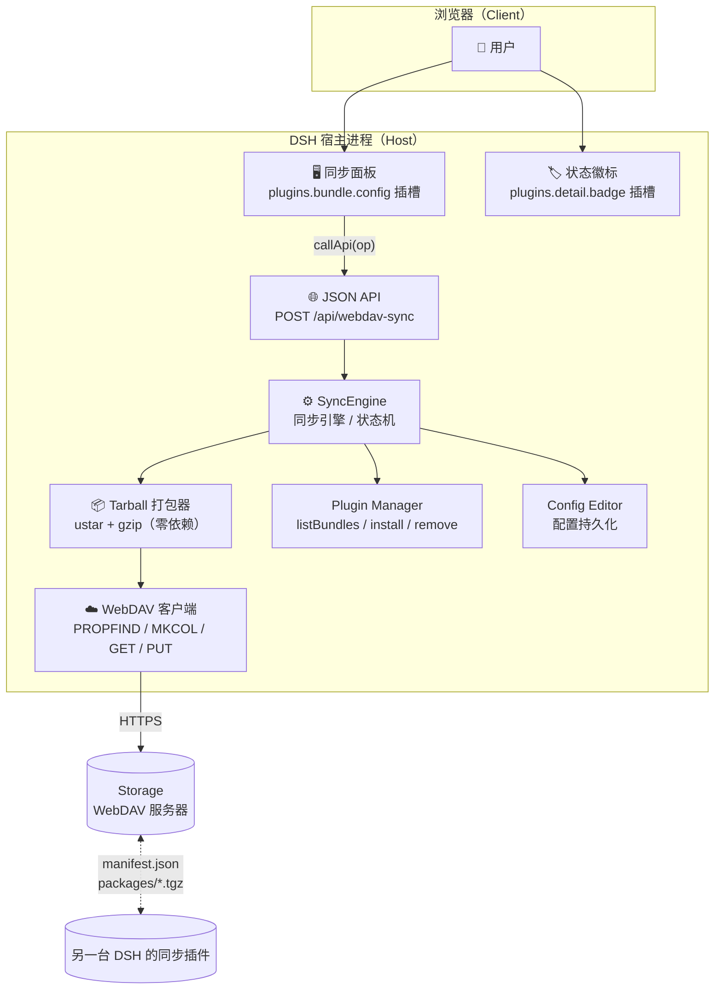
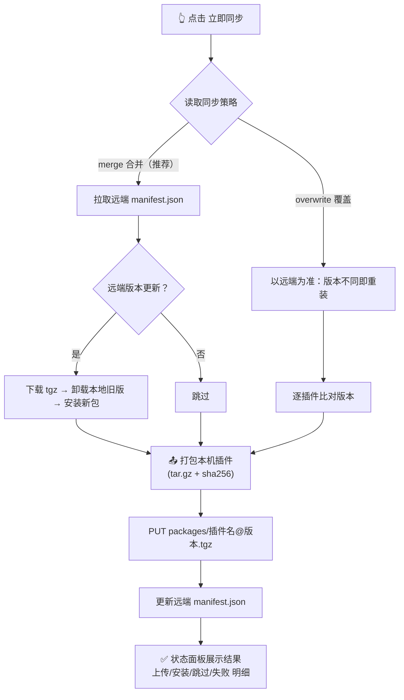
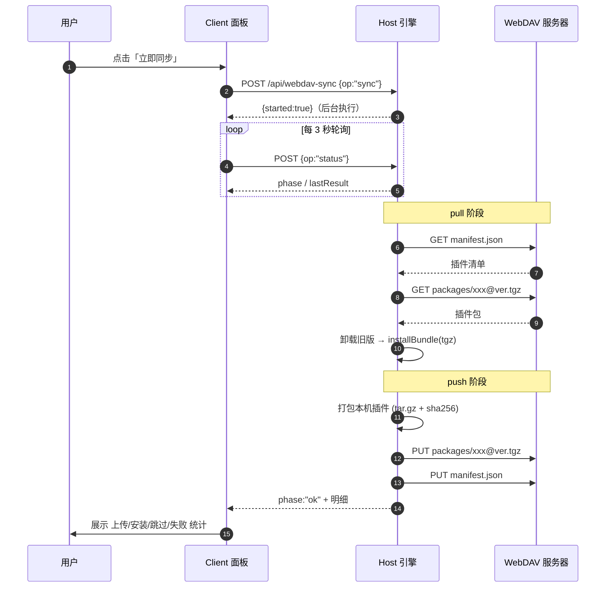

<div align="center">


# WebDAV Plugin Sync for DSH

**在多台 DSH 之间同步已安装插件，数据经你自己的 WebDAV 中转。**

*Sync installed DSH plugins across devices over your own WebDAV server.*

[](https://github.com/deepseek-ai/deepseek-harness)
[](#-许可证)
[]()
[]()

</div>

---

## 📖 这是什么

<!-- English: What is this -->

这是一个 [DeepSeek Harness（DSH）](https://github.com/deepseek-ai/deepseek-harness) 插件。装上它之后，你在一台 DSH 上安装的插件，可以通过 **WebDAV 网盘**（坚果云、Nextcloud、Alist、自建 WebDAV 等）同步到其他几台 DSH 上，再也不用逐台手动安装。

- 🔌 **插件级同步**：把本机已安装的插件打包成 `.tgz` 上传，另一端下载后自动安装
- 🗂️ **清单管理**：远端维护一份 `manifest.json`，记录每个插件的版本、校验和与来源设备
- 🔀 **两种策略**：合并（按 semver 取较新端）或覆盖（以远端为准）
- 🚫 **排除名单**：不想同步的插件可多选排除，本插件自身始终排除
- 🖥️ **状态可视**：同步状态、上次同步时间、逐插件明细直接展示在插件详情页
- 📦 **零构建依赖**：纯 JavaScript 实现（内置 WebDAV 客户端与 tar.gz 打包器），克隆即用

## 🏗️ 架构

<!-- English: Architecture -->

插件分为 Host（Node 侧）与 Client（浏览器侧）两半，通过 DSH 的插件插槽与 HTTP API 协作：



## 🔄 同步流程

<!-- English: Sync flow -->



<details>
<summary>📋 时序图（点开查看）</summary>



</details>

## 📦 远端目录结构

<!-- English: Remote layout on your WebDAV server -->

```text
{备份目录}/                        ← 默认 dsh-plugin-sync
├── manifest.json                 ← 清单：插件名、版本、sha256、来源设备、时间
└── packages/
    ├── dsh-windows-mcp@1.0.0.tgz
    ├── @local__moss-compaction-fix@1.0.0.tgz
    └── …
```

## 🚀 快速开始

<!-- English: Quick start -->

### 1. 安装插件

在 DSH 侧边栏 **插件 → 添加插件** 中输入：

```text
github:cczuishuai233/dsh_webdav_plugin
```

或命令行：`dsh plugin add github:cczuishuai233/dsh_webdav_plugin`

### 2. 配置 WebDAV

进入插件详情页，在 **同步设置** 中填写：

| 配置项 | 说明 | 默认值 |
| --- | --- | --- |
| **WebDAV 地址** | 如 `https://dav.jianguoyun.com/dav/` | 必填 |
| **用户名 / 密码** | WebDAV 凭据 | 必填 |
| **备份目录** | 远端根目录下的文件夹名 | `dsh-plugin-sync` |
| **同步策略** | 合并（推荐）/ 覆盖 | `merge` |
| **排除插件** | 多选，不参与同步 | 本插件自身 |
| **设备名** | 在 manifest 中标识本机 | 主机名 |

### 3. 开始同步

- **测试连接** → 确认凭据可用
- **立即同步** → 双向同步（先下载安装、再打包上传）
- **仅上传 / 仅下载** → 单向操作

## 🔀 同步策略

<!-- English: Sync strategies -->

| | 合并 merge（推荐） | 覆盖 overwrite |
| --- | --- | --- |
| 语义 | 两端并集，按 semver 保留较新版本 | 远端为准，版本不同即重装 |
| 本地较新时 | 保留本地，并将本地推到远端 | ⚠️ 本地会被降级为远端版本 |
| 适用场景 | 日常多端协作 | 以一台设备为“主库”分发 |

> ⚠️ **覆盖策略提示**：本地比远端新时也会被降级覆盖，覆盖前请先上传本地改动。

## ❓ 常见问题

<!-- English: FAQ -->

<details>
<summary><b>插件安装在哪里？同步的是什么？</b></summary>

DSH 插件安装在 profile 目录的 `node_modules` 中（如 `~/.dsh/profiles/desktop/node_modules`）。本插件同步的是这些**已安装的插件包**，不包含你的会话数据。
</details>

<details>
<summary><b>哪些插件不会被同步？</b></summary>

- 本插件自身（始终排除，避免递归安装）
- 你在排除列表中勾选的插件
- DSH 安装自带的只读内置插件（不在安装清单中，无法卸载重装）
</details>

<details>
<summary><b>多台设备同时同步会冲突吗？</b></summary>

manifest 采用“读取-合并-写回”，并发写可能相互覆盖。建议错开使用，或固定一台设备负责上传。
</details>

<details>
<summary><b>密码安全吗？</b></summary>

WebDAV 密码明文保存在本机 profile 配置文件中，不上传到远端。建议使用专用账号并限制目录权限。
</details>

## 🛠️ 本地开发

<!-- English: Local development -->

```bash
git clone https://github.com/cczuishuai233/dsh_webdav_plugin.git
cd dsh_webdav_plugin
npm install            # 安装 @deepseek-ai/schemastery

# 以本地目录方式安装到 DSH（热重载，改代码即时生效）
dsh plugin add ./dsh_webdav_plugin
```

## 📄 许可证

<!-- English: License -->

[MIT](LICENSE) © 2026
